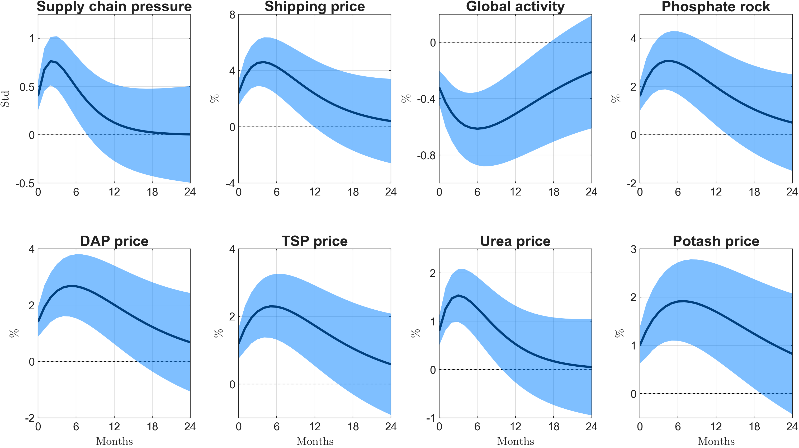
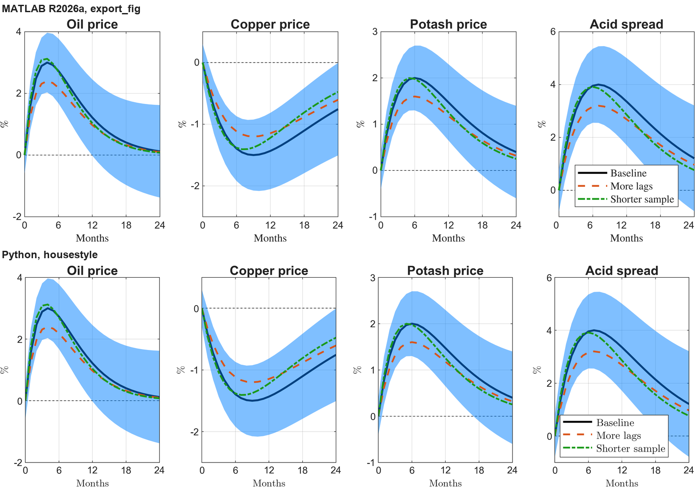
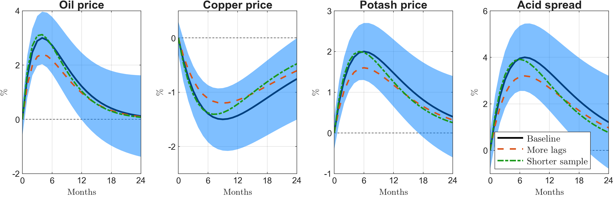
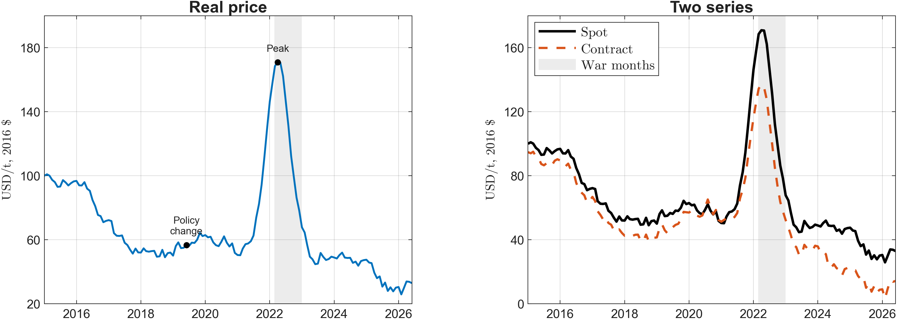
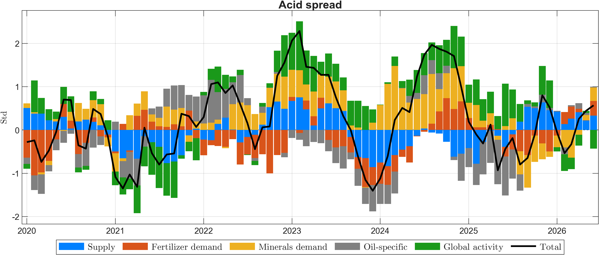

# housestyle

A Python package that draws paper figures in the mshipping MATLAB house style with
matplotlib: a black point estimate over a translucent blue band, a dashed zero line,
bold plain titles, Computer Modern axis labels, line styles that survive grey print,
and 300 dpi PNG export cropped to the content. It is calibrated against MATLAB R2026a
`export_fig` output of the same figures, so Python and MATLAB figures can sit side by
side in one paper.



## Install

```bash
py -m pip install -e path/to/housestyle
```

Needs Python 3.10+, matplotlib 3.8+ and numpy. No LaTeX install: labels use
matplotlib's built-in Computer Modern.

## Quick start

```python
import housestyle as hs

hs.outdir("figures")                         # export() writes here
fig, axes = hs.figure(2, 4)                  # 1180 x 600 MATLAB px, subplot layout
for k, ax in enumerate(axes.flat):
    ax.set_xticks(range(0, 25, 6))
    hs.irf(ax, h, med[:, k], lo[:, k], hi[:, k], names[k], "Std", "Months")
hs.export(fig, "irf_baseline")               # figures/irf_baseline.png, 300 dpi
```

Comparing specifications (draw everything, then `finish`):

```python
h1 = hs.line(ax, h, base, 1)                 # black solid
hs.band(ax, h, lo, hi)                       # blue band over it
h2 = hs.line(ax, h, alt1, 2)                 # orange dashed
h3 = hs.line(ax, h, alt2, 3)                 # green dash-dot
ax.set_xlim(0, 24)
hs.finish(ax, "Oil price", "%", "Months")    # labels, ticks, zero line
hs.legend(ax, [h1, h2, h3], ["Baseline", "More lags", "Shorter sample"])
```

Time series and decompositions:

```python
hs.line(ax, dates, price, "data")            # one observed series, MATLAB blue
hs.shade(ax, np.datetime64("2022-02-24"), np.datetime64("2022-12-31"), label="War months")
hs.event(ax, peak_date, peak_value, "Peak")
hs.finish(ax, "Real price", "USD/t, 2016 $")

bars = hs.bars(ax, dates, contributions)      # stacked, positives up, negatives down
hs.finish(ax, "Acid spread", "Std")
hs.legend(ax, bars, shock_names, outside="south")
```

Labels written for MATLAB's LaTeX interpreter port unchanged: `'\%'`, `'2016 \$'` and
`'$100\times\log$'` all work.

## Functions

| Function | Does |
|---|---|
| `figure(rows, cols, height, width)` | Figure in MATLAB pixels (1180 wide, 30 + 285 per row), panels placed by MATLAB's `subplot` rules |
| `irf(ax, h, med, lo, hi, title, ylabel, xlabel)` | One response panel: black median, band over it, zero line, labels |
| `line(ax, x, y, k)` | Series `k` = 1 to 4 in house order, or `"data"` for one observed series |
| `band(ax, x, lo, hi)` | Band in `[0 0.5 1]` at alpha 0.5, kept out of the legend |
| `zero(ax)` | Dashed zero line when 0 lies inside the y-limits, under the data |
| `shade(ax, x0, x1, label)` | Grey shaded episode over the full height, behind the data |
| `event(ax, x, y, label)` | Black dot with an 8 pt label |
| `bars(ax, x, Y)` | Stacked bars for decompositions, touching, no edges |
| `finish(ax, title, ylabel, xlabel)` | Bold title, LaTeX labels, MATLAB tick numbers, year ticks on dates, thins crowded y ticks keeping 0, zero line |
| `legend(ax, handles, labels, outside)` | LaTeX legend in a square box; `outside="south"` puts it below in one row |
| `years(ax, base)` | Year ticks on a date axis |
| `fit(fig)` | Shrink panels whose labels overflow their cell, as MATLAB does; `export` calls it |
| `outdir(path)` | Get or set the export folder |
| `export(fig, name)` | 300 dpi PNG (or PDF by suffix) on white, cropped to the content |
| `tex(label)` | The LaTeX conversion `finish` and `legend` apply |
| `MAIN BAND DATA SECOND THIRD FOURTH GREY STACK INK` | The palette |

`help(hs.finish)` and friends give the details. The rules are in [STYLE.md](STYLE.md).

## How close is it to MATLAB?



Matched by measurement against `images/matlab_reference`, MATLAB R2026a `export_fig`
output of the same example figures:

- Panel positions follow MATLAB's `subplot.m` geometry, including the shrink when
  labels overflow a cell and the room reserved for a legend below the axes. Image
  sizes agree within 1 percent.
- Fonts: tick labels 10 pt Arial (pixel-equal), titles 13.2 pt bold, labels 10.25 pt
  and legends 10.9 pt in Computer Modern.
- Colors: text and axes `#212121`, grid at 15 percent, the house palette.
- Lines: widths in points as in MATLAB; dashes 4 widths on and 4 off, dash-dot 4-1-2-1,
  scaled with line width as MATLAB does.
- Tick labels as MATLAB writes them (`0`, `0.5`, `-0.4`), inward ticks on all four
  sides with MATLAB's length, y limits rounded to ticks.

Differences that remain: matplotlib picks its own tick steps, which now and then
differ from MATLAB's; and Computer Modern comes from matplotlib's mathtext rather
than a TeX engine.

## Gallery

`py examples/run_examples.py` redraws these into `images/`.

| | |
|---|---|
|  |  |
| `example_compare.py` | `example_timeseries.py` |
|  |  |
| `example_decomposition.py` | `example_irf_grid.py` |

## Tests

```bash
py -m pytest
```

33 tests cover the geometry, labels, ticks, marks, legend layout and export.

## Layout

```
src/housestyle/     the package
examples/           example figures and run_examples.py
tests/              pytest suite
images/             gallery and the MATLAB comparison
images/matlab_reference/   MATLAB output the package is calibrated against
STYLE.md            the rules
```

Version 1.0.0, 31 October 2026. Hugo Morão.
