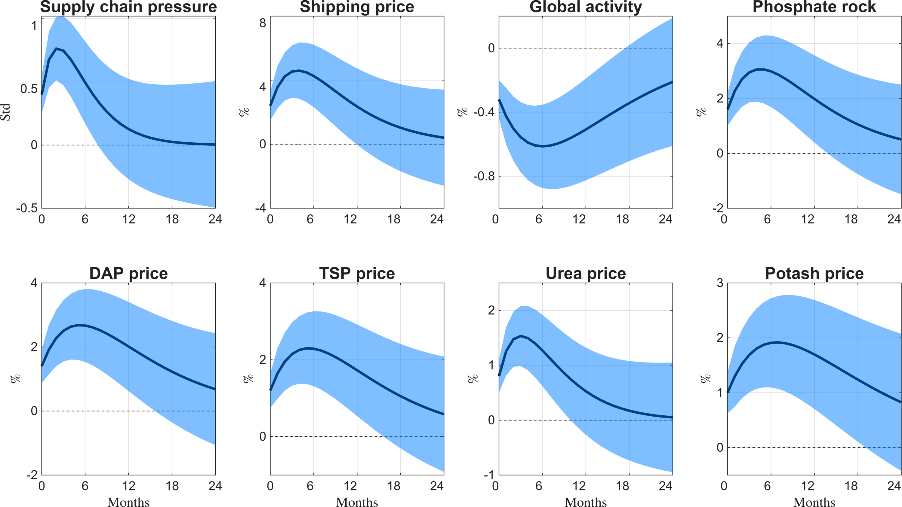
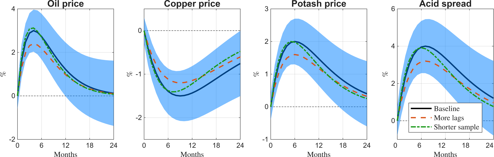
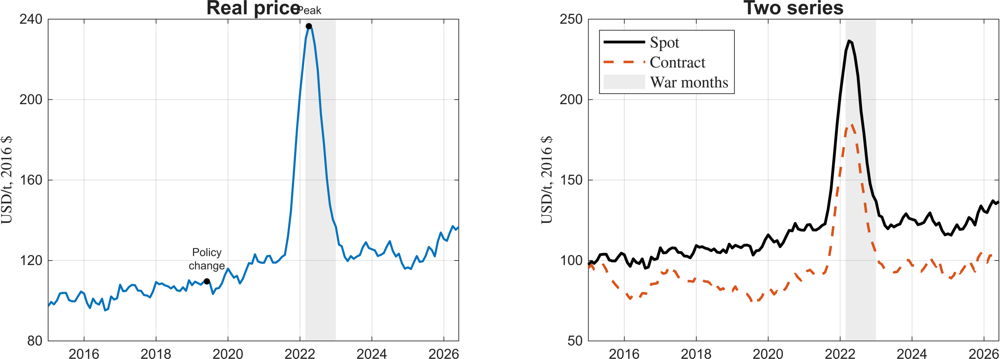
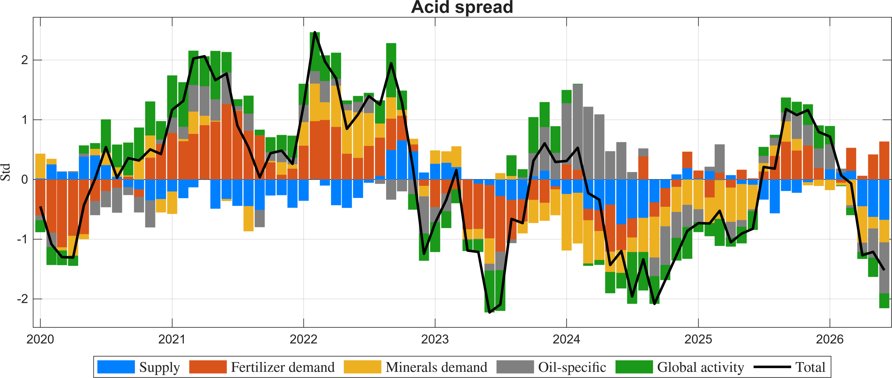

# housestyle

The MATLAB half of housestyle: helpers that draw paper figures in one house style: a black point estimate over
a translucent blue band, a dashed zero line, bold plain titles, LaTeX axis labels, line
styles that survive grey print, and 300 dpi PNG export through export_fig. The style
comes from the mshipping replication scripts (`regen_wcbaseline.m` and siblings).



## Install

Pick one:

- Double-click `release/housestyle.mltbx`. MATLAB installs it as an add-on and keeps
  it on the path.
- Or add the source folder to the path: `addpath('<this folder>/toolbox')`.

Then put [export_fig](https://github.com/altmany/export_fig) on the path. Without it,
`hs_export` falls back to `exportgraphics` at the same resolution and warns once.

## Quick start

```matlab
hs_outdir('figures');                 % hs_export writes here
hs_figure(2);                         % 1180 x 600 px, two rows of panels
for k = 1:8
    hs_axes(2, 4, k);                 % subplot, hold, grid, box
    hs_irf(0:24, med(:, k), lo(:, k), hi(:, k), names{k}, 'Std', 'Months');
end
hs_export('irf_baseline');            % figures/irf_baseline.png, 300 dpi
```

Comparing specifications:

```matlab
hs_axes(1, 4, k);
h1 = hs_line(h, base, 1);             % black solid
hs_band(h, lo, hi);                   % blue band over it
h2 = hs_line(h, alt1, 2);             % orange dashed
h3 = hs_line(h, alt2, 3);             % green dash-dot
xlim([0 24]); hs_zero();
hs_finish('Oil price', '\%', 'Months');
legend([h1 h2 h3], {'Baseline', 'More lags', 'Shorter sample'}, ...
    'Location', 'best', 'Interpreter', 'latex');
```

## Functions

| Function | Does |
|---|---|
| `hs_figure(rows, height, width)` | New figure, 1180 px wide, `30 + 285*rows` px tall, 13 pt font |
| `hs_axes(r, c, k)` | `subplot(r, c, k)` with hold, grid and box on; `hs_axes()` for one panel |
| `hs_irf(h, med, lo, hi, ttl, ylab, xlab)` | One response panel: black median, blue band, zero line, labels |
| `hs_line(x, y, k)` | Series `k` = 1 to 4 in house order, or `'data'` for one observed series |
| `hs_band(x, lo, hi)` | Band as a blue patch, `FaceAlpha` 0.5, kept out of the legend |
| `hs_zero()` | Dashed zero line when 0 lies inside the y-limits, under the data |
| `hs_shade(x0, x1)` | Grey shaded episode behind the data; x may be datetime |
| `hs_event(x, y, label)` | Black dot with an 8 pt label |
| `hs_finish(ttl, ylab, xlab)` | Bold title, LaTeX labels, 10 pt ticks, thins crowded y ticks keeping 0 |
| `hs_colors()` | Palette: `main`, `band`, `data`, `second`, `third`, `fourth`, `grey`, `stack` |
| `hs_outdir(dir)` | Get or set the folder `hs_export` writes bare names to |
| `hs_export(file, f, opts...)` | White background, 300 dpi PNG; options pass to export_fig |

`help <function>` gives the details. The full rules are in [STYLE.md](../STYLE.md).

## Gallery

The examples in `toolbox/examples` draw these from synthetic data. `run_examples(dir)`
redraws all four.

| | |
|---|---|
|  |  |
| `example_compare`: baseline, band, two alternatives | `example_timeseries`: shaded episode, events |
|  |  |
| `example_decomposition`: stacked bars, total line | `example_irf_grid`: 2 x 4 responses |

## Build and test

```matlab
addpath('<path to export_fig>');
build_toolbox        % runs the tests, redraws images/, writes release/housestyle.mltbx
```

`runtests('tests')` runs the 19 unit tests alone. Tested in MATLAB R2026a on Windows.

## Layout

```
toolbox/            functions (this folder goes on the path)
toolbox/examples/   example figures and run_examples
tests/              unit tests
images/             gallery, written by build_toolbox
release/            housestyle.mltbx, written by build_toolbox
../STYLE.md         the rules (shared with the Python package)
build_toolbox.m     test, draw, package
```

Version 1.0.0, 31 October 2026. Hugo Morão.
